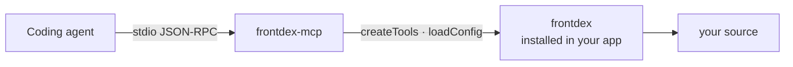

# frontdex-mcp

MCP server for [Frontdex](https://github.com/Prathmesh2000/frontdex). It gives coding agents (Claude Code, Cursor, OpenCode, Hermes and any other MCP client) the project's living frontend index: components, pages, data flow, global state, API calls, styles, health issues and history.



The server holds no analysis code of its own. Every answer comes from the core package's public API, and the core is a **peer dependency**, so the server always reads the index through the same version your project uses.

## Install

Both packages are devDependencies of your app:

```bash
npm install --save-dev frontdex frontdex-mcp   # or pnpm add -D / yarn add -D / bun add -d
npx frontdex agents                            # writes .mcp.json, Cursor and OpenCode config, rules and hooks
```

`frontdex agents` registers `npx frontdex mcp`, which starts this package from your project. To register it by hand instead:

```json
{ "mcpServers": { "frontdex": { "type": "stdio", "command": "npx", "args": ["frontdex-mcp"] } } }
```

`frontdex-mcp -C <dir>` targets another project root.

## Tools

| Tool | Returns |
|---|---|
| `catalogue_overview` | Counts, routers, folders, most shared components |
| `catalogue_search` | Components matching text and filters (`uses:Button`, `is:shared`, …) |
| `catalogue_component` | Full card: props, state, effects, renders, rendered by, pages |
| `catalogue_dataflow` | Props in per parent → store reads → state/effects → API calls → props out |
| `catalogue_impact` | Every component and page affected by changing one component |
| `catalogue_page` | A route's layouts, params and component tree, or all routes |
| `catalogue_state` | Redux slices, contexts, zustand stores with readers and writers |
| `catalogue_api` | Every API call grouped by endpoint |
| `catalogue_styles` | Where a CSS class is defined and used, or a component's styles |
| `catalogue_health` | Leaks, render loops, unsafe async, stale deps, dead code, with fixes |
| `catalogue_rescan` | Incremental rescan and what changed |
| `catalogue_history` | Knowledge-base snapshots, optionally for one component |
| `catalogue_find_existing` | Run before creating a component: existing ones with a similar name or props |
| `catalogue_duplicates` | Components that already look like duplicates of each other |
| `catalogue_tokens` | Design tokens and hard-coded values that should use them |

The server speaks the stateless 2026-07-28 MCP revision and the older initialize-handshake revisions (2025-11-25, 2025-06-18, 2025-03-26, 2024-11-05).

## Development

The core repo is expected next to this one (`../frontend-catalog`); the devDependency links it, and the tests run against its `examples/next-app`.

```bash
npm install
npm test
```

## Licence

MIT
