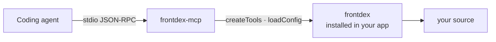

# frontdex-mcp

[](https://www.npmjs.com/package/frontdex-mcp)
[](https://github.com/Prathmesh2000/frontdex-mcp/actions/workflows/ci.yml)
[](LICENSE)

MCP server for [Frontdex](https://github.com/Prathmesh2000/frontdex). It gives coding agents (Claude Code, Cursor, OpenCode, Antigravity, Hermes and any other MCP client) the project's living frontend index: components, pages, data flow, global state, API calls, styles, health issues and history.



The server holds no analysis code of its own. Every answer comes from the core package's public API, and the core is a **peer dependency**, so the server always reads the index through the same version your project uses.

## Install

Both packages are devDependencies of your app:

```bash
npm install --save-dev frontdex frontdex-mcp   # or pnpm add -D / yarn add -D / bun add -d
npx frontdex agents                            # writes .mcp.json, Cursor and OpenCode config, rules and hooks
```

`frontdex agents` registers `npx frontdex mcp`, which starts this package from your project, for Claude Code (`.mcp.json`), Cursor (`.cursor/mcp.json`), OpenCode (`opencode.json`), Antigravity (`.agents/mcp_config.json`) and, with `--user-config`, Hermes (`~/.hermes/config.yaml`). To register it by hand, add a stdio server named `frontdex`:

```json
{ "mcpServers": { "frontdex": { "type": "stdio", "command": "npx", "args": ["frontdex", "mcp"] } } }
```

The exact file and format for each agent, plus the rules that tell the agent when to call these tools, are in [frontdex's agent guide](https://github.com/Prathmesh2000/frontdex/blob/main/docs/AGENTS.md). `frontdex-mcp -C <dir>` (or `frontdex mcp -C <dir>`) targets another project root, for agents that start servers outside the project.

## Tools

| Tool | Returns |
|---|---|
| `catalogue_overview` | Counts, routers, folders, most shared components |
| `catalogue_search` | Components matching text and filters (`uses:Button`, `is:shared`, …) |
| `catalogue_component` | Full card: props, state, effects, renders, rendered by, pages |
| `catalogue_dataflow` | Props in per parent → store reads → state/effects → API calls → props out |
| `catalogue_impact` | Every component and page affected by changing one component |
| `catalogue_page` | A route's layouts, params and component tree, or all routes |
| `catalogue_state` | Redux slices, contexts, zustand stores with readers and writers |
| `catalogue_api` | Every API call grouped by endpoint |
| `catalogue_styles` | Where a CSS class is defined and used, or a component's styles |
| `catalogue_health` | Leaks, render loops, unsafe async, stale deps, dead code, with fixes |
| `catalogue_rescan` | Incremental rescan and what changed |
| `catalogue_history` | Knowledge-base snapshots, optionally for one component |
| `catalogue_find_existing` | Run before creating a component: existing ones with a similar name or props |
| `catalogue_duplicates` | Components that already look like duplicates of each other |
| `catalogue_tokens` | Design tokens and hard-coded values that should use them |
| `catalogue_owners` | CODEOWNERS, tests/stories and live git activity for a component |
| `catalogue_adoption` | Usage of a component across knowledge-base snapshots |
| `catalogue_hooks` | Custom hooks with what they read and call, and who uses them |
| `catalogue_diff` | The current change vs a git ref: components/pages changed, pages reached, new issues |
| `catalogue_tests` | Unit and E2E tests covering a component, page or file, with the command to run them |
| `catalogue_enrich_next` | Components whose docs are missing or stale, with the facts needed to write them |
| `catalogue_enrich_write` | Save docs for a component (purpose, props and how to pass them, functions, usage, notes) into the knowledge base |
| `catalogue_docs` | A component's saved docs, or docs coverage for the project |

The server speaks the stateless 2026-07-28 MCP revision and the older initialize-handshake revisions (2025-11-25, 2025-06-18, 2025-03-26, 2024-11-05).

## Contributing

See [CONTRIBUTING.md](CONTRIBUTING.md); coding agents should read [AGENTS.md](AGENTS.md). Short version: `npm ci && npm test`. The tests run against the `frontdex` devDependency and its `examples/next-app`. Tool behaviour lives in [frontdex](https://github.com/Prathmesh2000/frontdex) `src/tools.js`; this repo holds the tool schemas and the transport.

## License and credit

Open source under the [Apache License 2.0](LICENSE), created by [Prathmesh Agrawal](https://github.com/Prathmesh2000). Use it, change it and ship it, commercially or not; if you redistribute it or a modified version, keep the [LICENSE](LICENSE) and [NOTICE](NOTICE) files and mark the files you changed. Versions up to 0.2.x were published under MIT and remain available under it.
